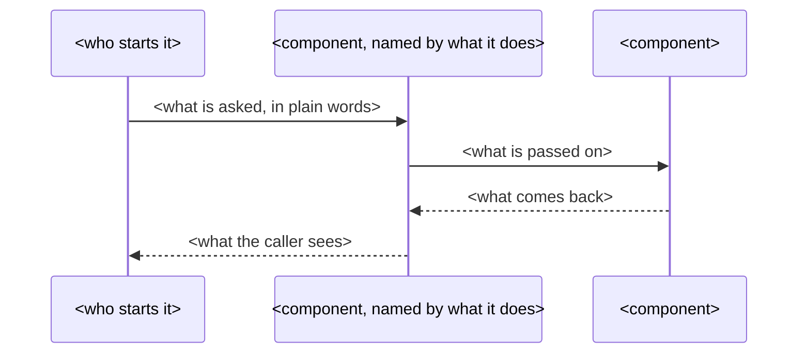

# Step Summary Template

Copy into the project as `docs/steps/TEMPLATE.md`. For every step, the implementing agent
writes `docs/steps/SNN.md`: a one-screen summary of the change, in plain terms, with a
diagram. It is written **before the step's code** so it states the intent, and corrected
at the end of the step so it matches what was built.

It is for a human who does not want to read the code. No code in it.

````md
# S<NN> - <goal>

## In one sentence

<What works after this step that did not work before.>

## How it works



## What changes

- **<Part, in plain words>** - <what it does. One line.>
- **<Part>** - <...>

## Choices you might want different

- <A choice made here, and the alternative. One line.>
````

## Rules

- **One sentence.** What works after this step that did not before. Not what was edited.
- **One diagram, chosen by what the step is about:**
  - a **sequence diagram** when the step is about components calling each other;
  - a **state or flow diagram** when it is about states or branching;
  - **none** when there is nothing to draw - leave the section out, and do not say so.

  Mermaid by default; a plain-text diagram if the human says they read these in a terminal.
- **Three to six bullets** under What changes: what each part does, in plain words rather
  than function names. "The part that decides whether a request is a duplicate", not
  `is_duplicate()`. A technical term the human has not used gets a few words of
  explanation or gets replaced.
- **Up to three choices** the human might want made differently - only real ones, where a
  reasonable person might have gone the other way and it would be annoying to change
  later. Leave the section out when there are none.
- **No code.** No snippets, no diffs, no signatures, no file-by-file list, no edge cases,
  no error-handling detail. If the human wants depth on one part, they ask for that part.
- **One screen.** If it needs more than six bullets or more than one diagram, the step is
  too big: split it and log the split.
- **True at the end.** If what was built differs from what was written first, rewrite the
  summary to describe what was built. It is committed with the step.
